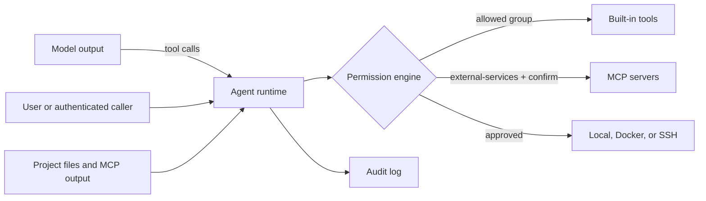

# Security Policy

## Supported versions

| Version | Supported                             |
| ------- | ------------------------------------- |
| `0.3.x` | yes, active release line              |
| `0.2.x` | security fixes only until 0.4.0 ships |
| `0.1.x` | no                                    |
| `main`  | yes, development                      |

## Reporting a vulnerability

Report privately through [GitHub security advisories](https://github.com/rsyyd/larecode/security/advisories/new). Please include:

- the larecode version (`larecode --version`) and your OS,
- a minimal reproduction, and
- the impact you see.

Do not open public issues for exploitable bugs.

## Response targets

These are best-effort targets, not a commercial SLA:

| Step                                     | Target                    |
| ---------------------------------------- | ------------------------- |
| Acknowledge the report                   | 3 business days           |
| Initial severity assessment              | 7 calendar days           |
| Fix or mitigation for critical/high      | 14 calendar days          |
| Fix for moderate/low                     | next patch or minor       |
| Public advisory after a fix is available | coordinated with reporter |

If a report is accepted, the fix ships with a GitHub security advisory and a changelog entry. A CVE is requested when the issue affects downstream distributions or other projects. Reporters are credited unless they ask otherwise. If a report is declined, the reason is recorded in the advisory thread.

You can verify a release before running it; see [Release checklist](docs/release.md#verify-a-release).

## Scope

Lare Code runs on your machine with your permissions. The trust model below is about keeping that power deliberate, not ambient. Anything not listed as a boundary is out of scope.

### Out of scope

- Multi-tenant use of the gateway or HTTP server. v1 assumes the caller is the device owner.
- A malicious model provider. If your endpoint lies, your output lies.
- OS-level sandboxing of the `local` execution backend. Use the `docker` backend for that.
- Adversarial input to the TUI itself. Terminal escape sequences in model output are a known, accepted risk.

### Boundaries

| Surface              | Trust level           | Controls                                                                                                                                 |
| -------------------- | --------------------- | ---------------------------------------------------------------------------------------------------------------------------------------- |
| Permission engine    | Enforcer              | Default-deny groups, `secrets`/`destructive` never auto-approved, audit log                                                              |
| Built-in tools       | Gated                 | Every tool maps to a permission group; unknown names default to `write`                                                                  |
| Project files        | Untrusted input       | Instruction files (AGENTS.md and friends) need consent; a changed hash revokes it                                                        |
| MCP servers (client) | Untrusted             | SHA-256 config fingerprint trust, explicit `mcp trust`, public HTTP addresses by default, `external-services` group, 15s request timeout |
| MCP server (mode)    | Untrusted clients     | Default read-only, `--allow` to widen, `secrets`/`destructive` refused at startup                                                        |
| HTTP server          | Authenticated callers | Bearer tokens, per-token scopes (`read`/`write`/`run`), timed-safe compare, body size limit                                              |
| Share links          | Public by token       | Unguessable token, secrets redacted at render time, revocable                                                                            |
| Gateway              | Single owner          | Chat allowlist; the remote human is the device owner, multi-user is a non-goal                                                           |
| Execution backends   | Contained by choice   | Docker runs with `--network none` unless opted in; SSH is key-only batch mode                                                            |
| Local secrets        | Do not leak           | Config files written `0600`; logging redacts secret-shaped values                                                                        |

The model, project files, and MCP output are untrusted. Only the permission engine decides whether a validated tool call runs.

## Supply chain

- Runtime dependencies are intentionally few and permissively licensed (`@modelcontextprotocol/sdk` MIT, `@ast-grep/napi` MIT). `THIRD_PARTY_NOTICES.md` lists every bundled package and its license.
- CI runs `bun audit --audit-level=high` and a full lockfile install with `--frozen-lockfile`.
- Release binaries are built in GitHub Actions from tagged commits, uploaded with `checksums.txt`, and signed keylessly with Sigstore cosign. `install.sh` verifies the checksum when one is provided.
- `larecode update` reports versions and instructions; it never executes an upgrade on its own.

Dependency cadence and exception handling live in [Dependency policy](docs/dependencies.md).
